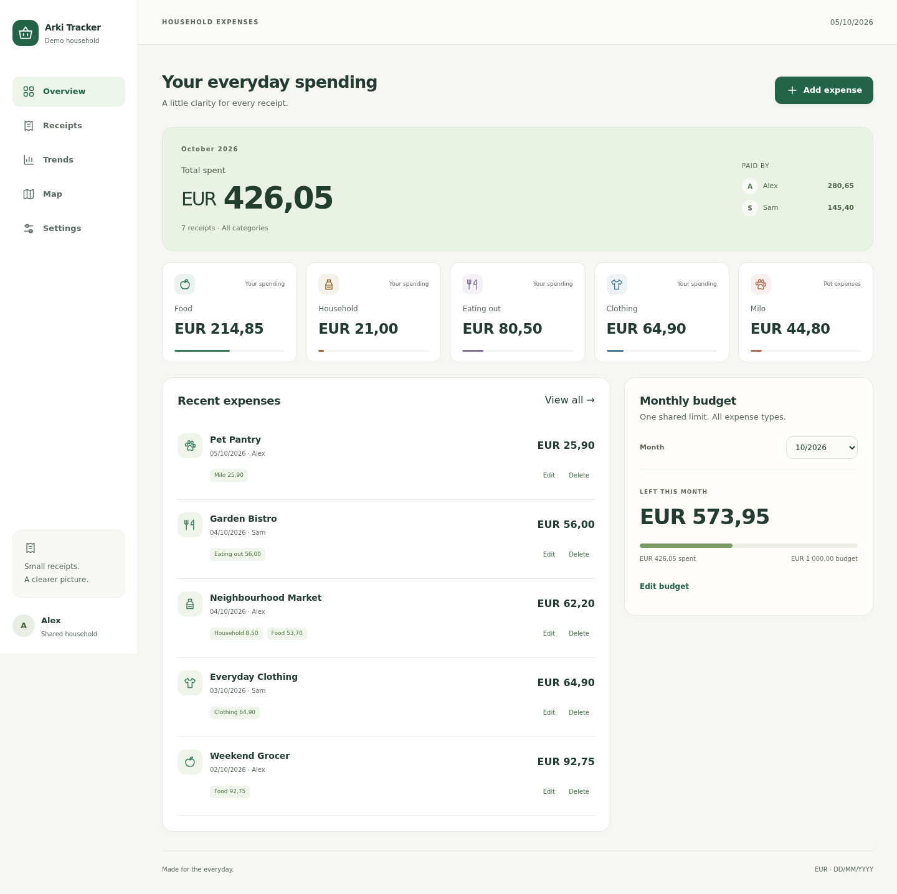
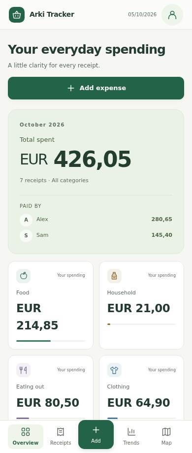
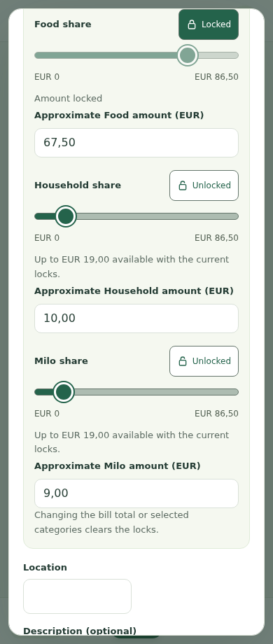

# Arki Tracker

*Everyday expenses, together.*

A self-hosted spending tracker for one household, with individual accounts, configurable categories, named pets, shared receipts, a monthly budget and purchase maps.

A new installation starts with an empty database and a first-run wizard. No sample receipts or default user accounts are created.

## Features

- Choose Food, Household, Eating out and Clothing, or optional Transport, Health, Leisure, Gifts, Home, Education and Other categories.
- Add custom categories, pick their icons and colours, and create a separate category for each named pet.
- Split any receipt across its selected categories using amounts or lockable sliders. Unlocked categories share adjustments evenly; locked amounts remain fixed. Slider scales always use the bill total.
- See monthly/yearly totals, category charts and contributions by person. Filter receipts, export CSV and set one shared monthly budget.
- Save precise shop names and pins, search by address, find nearby shops, and view purchase counts and a heatmap.
- Administrators manage categories, household settings and accounts. Members can manage shared receipts, shop pins and the budget. Archive categories and deactivate users without deleting receipt history.
- Phone-friendly interface and Home Screen icons. Dates use **DD/MM/YYYY**; amounts accept a comma or decimal point. Currency is chosen once per household before recording receipts. Supported currencies use two decimal places; no exchange-rate conversion is performed.

## Screenshots

Real browser captures using a fictional demo household. No personal accounts, receipts or locations are shown.

### Desktop overview



### Mobile overview and receipt splitting

<p>
  
  
</p>

[See the setup wizard and more mobile screenshots](docs/screenshots.md).

## Quick start

Requirements: Docker with Compose, and Node.js 22 or later to generate installation secrets.

```sh
git clone https://github.com/gezuka77/arki.git
cd arki
node scripts/configure.mjs
docker compose up -d --build
```

Open **http://localhost:8080** on the server. If the server is remote, forward the port through SSH or put it behind your own HTTPS reverse proxy. The default Compose file binds only to `127.0.0.1`; it does not publish the application directly to the internet.

Read `SETUP_TOKEN` from the local `.env` file, then follow the wizard:

1. Enter the installation token, household name and currency. Optionally choose a city or use your current location to prepare faster nearby-shop searches. Choose an area of about 5, 10 or 20 km, or skip it.
2. Choose categories and add custom categories or named pets. The first category is the initial allocation for new receipts.
3. Create the first administrator and optional household members. Passwords require at least 12 characters and at most 72 UTF-8 bytes.
4. Review and create the household, then sign in.

`configure.mjs` generates independent random setup and session-signing secrets and refuses to overwrite an existing `.env`. Setup is permanently closed after initialization. Do not commit or share `.env` or your data volume.

To use a different local port, change `HOST_PORT` in `.env`. Do not change the Compose project name after storing data unless you deliberately reconnect the existing volume.

## Household administration

Open **Settings → Household administration** as an administrator. Add, rename, recolour or archive categories and pets. Choose a different default before archiving the current default category. Archived allocations remain visible in history and can be edited on their existing receipts, but cannot be added to new receipts.

Users have individual local accounts; Arki Tracker does not include public signup, email invitations or password-reset email. An administrator can add users, reset another user's password, change their role or deactivate them. Account changes revoke existing sessions. The final active administrator cannot be demoted or deactivated. Every user can change their own password in Account settings.

All household members share access to receipts and the budget. This is **one household per installation**, not a multi-tenant service.

## Maps and privacy

Phone location is requested only after pressing **Nearby shops**, **Use my current location** when placing a manual pin, or **Use current location** in area setup. Phone coordinates are not saved automatically. If you confirm a manual pin at your current position, those coordinates are saved as the place location. Shop names and map pins are saved only after confirmation. Nearby-shop search shows a loading message while finding your position and looking up shops.

By default, place search uses public Photon and Overpass services and map imagery uses OpenStreetMap tiles. These services receive the requests needed for their feature: search text, a coarse nearby search area, or viewed map tile coordinates, respectively. They have usage policies and no application-specific uptime guarantee. Configure your own provider endpoints for higher usage. Users can enter a shop name without a map pin. For temporary stalls or events, choose **Add precise location → Use my current location**, keep a custom place name, adjust the pin and confirm. Phone accuracy is shown; nothing is saved automatically. If location access fails, search for the venue address or place the pin manually.

An optional regional directory removes external nearby-search latency in a chosen area. Choose it in the wizard or **Settings → Household administration**. The approximate centre is also used as the starting area for manual maps. Phone coordinates are rounded before being saved; this prepares shop lookup, not GPS acquisition. The screen shows download progress, ready shop counts or retry status. A new area is downloaded before it replaces the old directory, and searches outside prepared coverage continue to use cached/provider results.

Outside the prepared area, nearby searches still work through the external provider and cache their results. See the [administration guide](docs/administration.md) for provider configuration, directory management and diagnostics.

Map data: © [OpenStreetMap contributors](https://www.openstreetmap.org/copyright), licensed under ODbL. Map provider attribution is retained in the interface.

## Documentation

- [Administration guide](docs/administration.md): hosting, backups, map providers and upgrading older installations.
- [Screenshot gallery](docs/screenshots.md): desktop, mobile and setup views.
- [Contributing](CONTRIBUTING.md): development, tests and documentation maintenance.
- [Security and privacy](SECURITY.md): security reporting and deployment considerations.

## License

MIT. See [LICENSE](LICENSE). Dependency and OpenStreetMap data licenses remain applicable separately.

### Express 5

The backend uses Express 5 on Node 22. SPA fallback routes use the named wildcard `/{*splat}` to include the root path. Backend tests exercise server startup with and without built frontend files, deep-link fallback, missing assets and API 404 responses.
