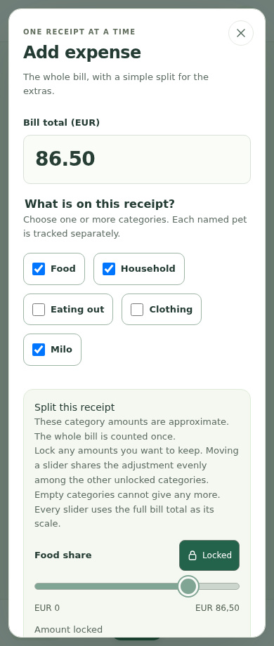
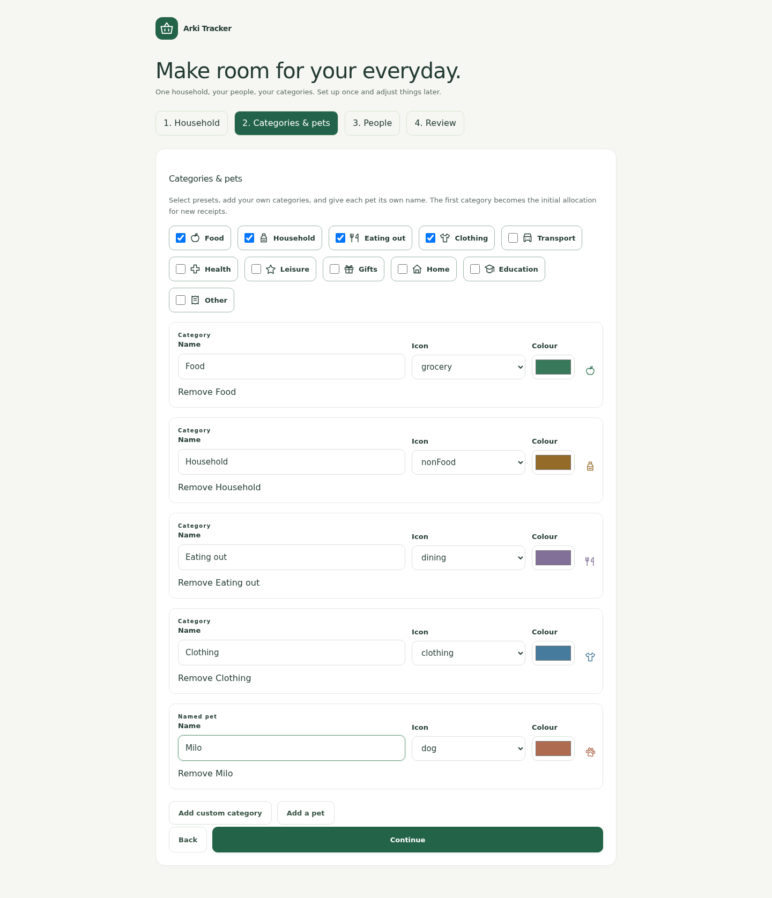

# Arki Tracker screenshots

These are real browser captures of an isolated demo installation. All account names, shops, receipts and pet names are fictional. The example data is not bundled into a normal installation.

Desktop captures use a 1440 px-wide viewport. Mobile captures use a 390 × 920 px browser viewport; they show the responsive website, not native iOS browser chrome.

## Desktop overview

## Mobile overview

## Add an expense on mobile

Choose the categories on the receipt before adjusting the split.

## Adjust and lock category amounts

The same receipt, scrolled to its split controls. Locking Food keeps its amount fixed while the remaining unlocked categories share adjustments.

## First-run setup

Select preset categories, customize their icons and colours, and add named pets.

